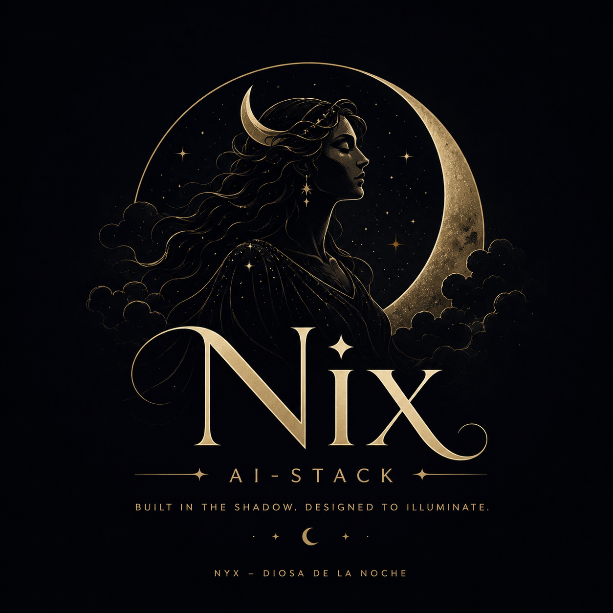

<p align="center">
  
</p>

<h1 align="center">Nix</h1>

<p align="center">
  <strong>Built in the shadow. Designed to illuminate.</strong>
</p>

<p align="center">
  An open-source AI stack for disciplined software delivery.
</p>

<p align="center">
  <em>Repository setup in progress — public URL coming soon.</em>
</p>

---

## Why Nix

Most AI coding setups optimize for speed first and thinking second.

Nix goes the other way.

Nix is being built as an opinionated AI stack for engineers who want structure, verification, and long-term ownership — not prompt chaos, disposable automation, or black-box habits.

It keeps the strongest ideas from proven workflows and rebuilds them under a system that is modular, explicit, and fully extensible.

## Vision

Nix exists to make AI-assisted development feel less like improvisation and more like engineering.

The goal is to provide a stack where:

- planning is intentional,
- implementation is disciplined,
- verification is mandatory,
- memory survives across sessions,
- and specialization grows through reusable skills and agents.

## Core foundations

Nix starts from five non-negotiable foundations:

- **SDD** — Spec-Driven Development for intentional change design
- **Strict TDD** — tests are part of delivery, not decoration
- **Reviewers** — quality gates for implementation and delivery
- **Judgment Day** — adversarial review for high-confidence validation
- **Engram** — persistent memory for continuity across sessions

These are not side features. They are the spine of the stack.

## What Nix is building

Nix is a TypeScript CLI prototype. The directories below show the current implementation; future workflow modules remain part of the product direction, not delivered features.

```text
agents/              # Agent, architecture, reviewer, and skill guidance
docs/                # Roadmap and planning artifacts; approved issue briefs will live here
skills/              # Reusable project skills and templates
src/
├── cli/             # Current CLI commands and entry point
└── core/            # Architecture, config, contracts, reviewers, stack heuristics, and system helpers
```

## Design principles

| Principle | Meaning |
|----------|---------|
| Ownership over dependence | Nix owns the contracts, boundaries, and workflow semantics |
| Adapters over coupling | External systems stay behind explicit interfaces |
| Skills before agents | Repeated workflows become skills before they become specialists |
| Verification over vibes | Delivery must be reviewable, testable, and explainable |
| Evolution by design | The stack should grow without collapsing into prompt spaghetti |

## Current status

Nix is an early CLI prototype and a user-scope AI stack. It currently provides an installer TUI, global installation and lifecycle management for the Apache-2.0 Nix Core Codex skill, opt-in global destructive-operation safeguards for Codex and OpenCode, independently configurable SDD and TDD workflows with resumable project-keyed records under the Nix home, a workflow command catalog (`/new-feat`, `/refactor`, `/new-idea`) with global OpenCode commands and Codex user skills, optional global MCP integrations (Playwright, CodeGraph, Engram, and REA), a pinned stack-aware skill catalog with seven external skills, an isolated blind-judge idea-evaluation engine, configuration initialization, a doctor report, reviewer listing and heuristic reviewer reports, architecture recommendations, and a checksum-verified release manifest with an end-to-end lifecycle test suite. The public `stack:scan` command has been removed; repository-scanning heuristics remain an internal dependency of the prototype reviewer command and are not a supported standalone feature.

Nix owns its state under a single global home: `NIX_AI_HOME` when set, otherwise `%APPDATA%\\Nix AI Stack` on Windows or `$XDG_CONFIG_HOME/nix-ai` (falling back to `~/.config/nix-ai`) elsewhere. Stack state, configuration, managed records, backups, project workflow records, and idea records live there. Agent surfaces are also global: OpenCode uses `~/.config/opencode`, and Codex uses `$CODEX_HOME` or `~/.codex`, with user skills at `~/.agents/skills`. Nix preserves existing configuration and refuses to overwrite unmanaged targets. Codex custom slash prompts are deprecated upstream and are not used; Codex receives workflow skills instead. Additional agent adapters and AI-backed review workflows are not implemented yet. Security hooks are global, opt-in advisory safeguards for Windows shells; they are not a sandbox. External skills are installed from pinned upstream commits and are not vendored in this repository. The blind-judge engine enforces context isolation but is not a process sandbox; it is available through `/new-idea` and `workflow:command`. Release checksums detect corruption and drift but are not a signature; digital signing is not implemented. See [the installation guide](docs/installation.md), [the release and compatibility guide](docs/release.md), [the support matrix](docs/support-matrix.md), [the component catalog](agents/component-catalog.md), [the security hook model](agents/security-hooks.md), [the workflow model](agents/workflows.md), [the workflow command catalog](agents/command-catalog.md), [the skill catalog](agents/skill-catalog.md), and [the blind-judge protocol](agents/blind-judge.md) for supported behavior and limits.

## Getting started

Install Node.js 20.11+ and run `npm install`, then use the CLI below. V1 targets Windows with OpenCode and Codex; the current executable is `nix-ai`. For the full clean-install, upgrade, rollback, and removal path, read [the installation guide](docs/installation.md).

### Quick path

1. Install Node.js 20.11+.
2. Run `npm install`.
3. Run `npm run doctor`.
4. Explore `npm run reviewers:list`.
5. Run `nix-ai` to open the TUI, or preview the Codex skill with `nix-ai component --action=preview --root=.`.
6. Install it globally for Codex with `nix-ai component --action=install --root=. --yes`.
7. From the TUI, open **Manage global security hooks** to preview and opt into destructive-operation safeguards.
8. Enable SDD and/or TDD independently with `nix-ai workflow:configure --sdd=on --tdd=on --yes`, then inspect state with `nix-ai workflow:status`.
9. Preview and install optional global MCP integrations with `nix-ai mcp:list` and `nix-ai mcp:preview --id=codegraph --agent=opencode --root=.`.
10. Review the skill catalog with `nix-ai skill:list`, preview one with `nix-ai skill:preview --id=brag --agent=codex --root=.`, and install it with `nix-ai skill:install --id=brag --agent=codex --root=. --yes`.
11. Discover workflow commands with `nix-ai workflow:commands`, then install global OpenCode commands with `nix-ai workflow:install-commands --agent=opencode --root=. --yes` or Codex skills with `--agent=codex`.
12. Verify a release build with `npm run release:check`; the checksum manifest is written to `dist/release-manifest.json`.

Component lifecycle actions are `preview`, `install`, `update`, `backup`, `list-backups`, `restore`, and `uninstall`. Mutating actions require `--yes`; installation targets and managed records are global. The TUI offers a preview and asks for confirmation before installing or updating a global surface.

### Repository reading path

1. Read [the product vision](agents/product-vision.md).
2. Read [the architecture foundation](agents/architecture.md).
3. Read [the roadmap](docs/roadmap.md).
4. Check [the repository instructions](AGENTS.md) and [the skill style guide](agents/skill-style-guide.md).
5. Browse the [agent system](agents/agent-system.md), [agent roadmap](agents/tech-agent-roadmap.md), [skill/agent matrix](agents/skill-agent-matrix.md), and [reviewer guidance](agents/reviewer-strategy.md).

### Current repository focus

| Area | Status |
|------|--------|
| Brand and vision | Ready |
| Architecture foundation | Ready |
| Agent and skill conventions | Ready |
| TypeScript CLI prototype | Available; see the commands above |
| Public `stack:scan` command | Removed; internal heuristics remain for `reviewers:run` |
| Codex Nix Core skill lifecycle | Available; installed under `~/.agents/skills/nix-core` |
| Global destructive-operation safeguards | Available for Codex and OpenCode; opt-in, Windows shells only |
| Optional SDD/TDD workflows | Available as independent settings with resumable project-keyed records under the Nix home; execution is exposed through the workflow command catalog |
| Workflow command catalog | `/new-feat` (SDD), `/refactor` (TDD), `/new-idea` (blind-judge), and `/new-project` (project skill/agent generator); CLI executor, global OpenCode commands, and Codex user skills |
| Optional MCP integrations | Playwright, CodeGraph, and Engram available globally for OpenCode and Codex via CLI |
| Stack-aware skill catalog | Seven external skills pinned by commit, installed globally for OpenCode and Codex; compatibility matrix and authoring path available |
| Blind-judge idea evaluation | Isolated pro/con groups, five neutral evaluators, bounded synthesis, audit hashes, and a project skill; available through `/new-idea` and `workflow:command` |
| Release packaging and checksums | SHA-256 manifest for `dist/`, verify command, compatibility contract, and `npm run release:check`; signing not implemented |
| Additional agent adapters | Not implemented |

## Documentation

- [Product vision](agents/product-vision.md)
- [Architecture foundation](agents/architecture.md)
- [Roadmap](docs/roadmap.md)
- [Installation and first run](docs/installation.md)
- [Release and compatibility](docs/release.md)
- [Support matrix](docs/support-matrix.md)
- [Component catalog](agents/component-catalog.md)
- [Skill style guide](agents/skill-style-guide.md)
- [Agent system guidance](agents/agent-system.md)
- [Tech agent roadmap](agents/tech-agent-roadmap.md)
- [Skill and agent matrix](agents/skill-agent-matrix.md)
- [Reviewer specification](agents/reviewer-spec.md)
- [Reviewer strategy](agents/reviewer-strategy.md)
- [Security hooks and destructive-operation safeguards](agents/security-hooks.md)
- [Optional SDD and TDD workflows](agents/workflows.md)
- [Workflow command catalog](agents/command-catalog.md)
- [Optional MCP integrations](agents/mcp-integrations.md)
- [Skill catalog and installation](agents/skill-catalog.md)
- [Skill compatibility matrix](agents/skill-compatibility.md)
- [Project skill authoring](agents/skill-authoring.md)
- [Blind-judge idea evaluation](agents/blind-judge.md)
- [Architecture selector guidance](agents/architecture-selector.md)
- [Pattern review rules](agents/pattern-review-rules.md)
- [Technology stack inventory](agents/stack-inventory.md)

## Contributing

Nix is intended to be open source, but not directionless.

If you want to contribute, the expectation is simple:

1. understand the architecture before adding abstractions,
2. preserve clear module boundaries,
3. prefer reusable skills over vague agent sprawl,
4. treat tests, reviews, and documentation as part of the change.

If a contribution makes the stack faster but less understandable, it is probably the wrong contribution.

Before opening a PR, read:

- `C:\Proyectos\Nix\CONTRIBUTING.md`
- `C:\Proyectos\Nix\CODE_OF_CONDUCT.md`
- `C:\Proyectos\Nix\SECURITY.md`

## Long-term direction

Over time, Nix will grow into a system with:

- specialist agents for recurring technology domains,
- project skills for repetitive engineering workflows,
- strong orchestration rules,
- portable provider contracts for memory and review systems.

The point is not to have “more AI”.

The point is to have a better-engineered AI stack.

## Philosophy

Nix is inspired by a simple belief:

> AI should accelerate disciplined engineering, not replace it.

## License

This project is licensed under the MIT License. See `C:\Proyectos\Nix\LICENSE`.
